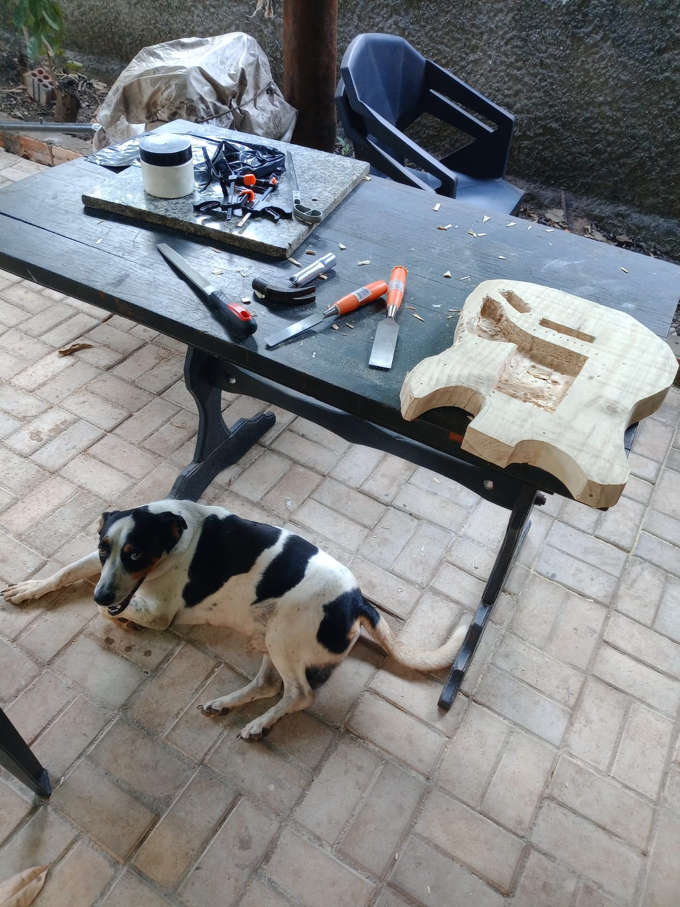
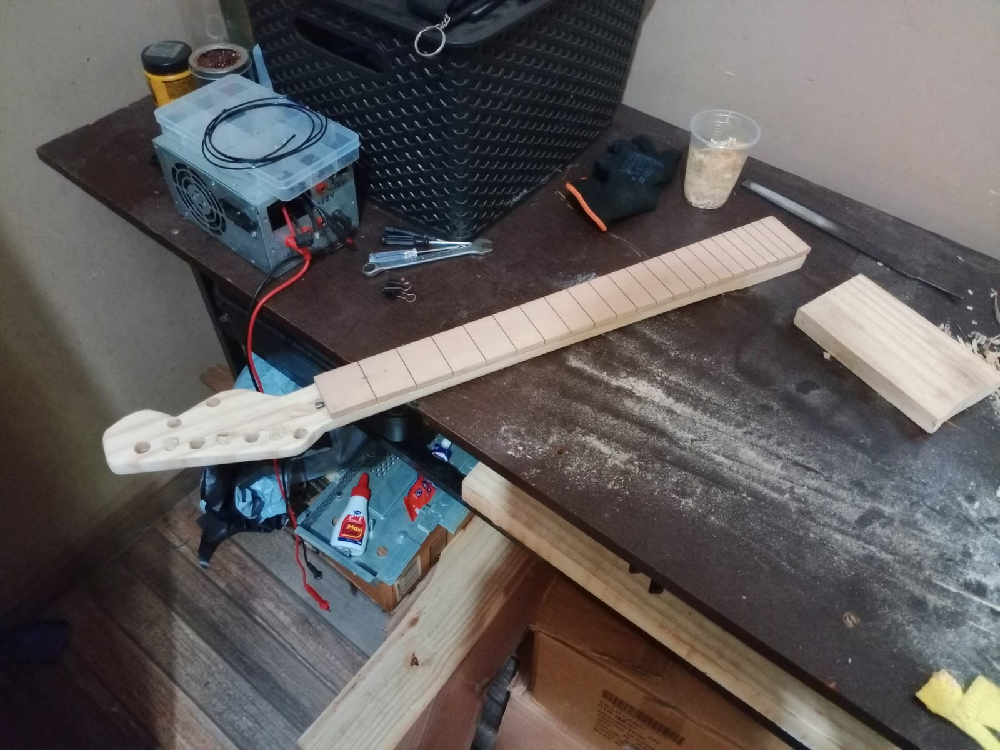
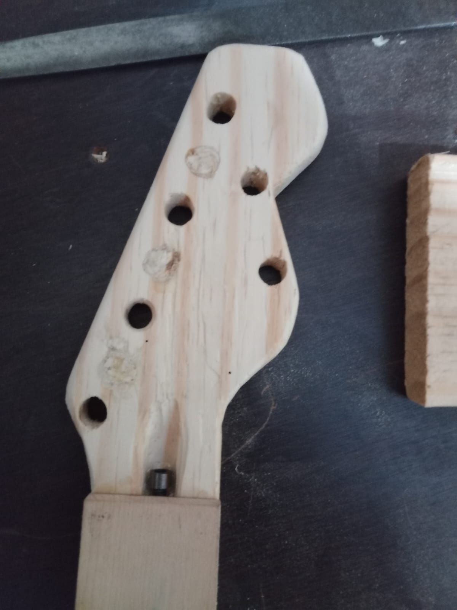
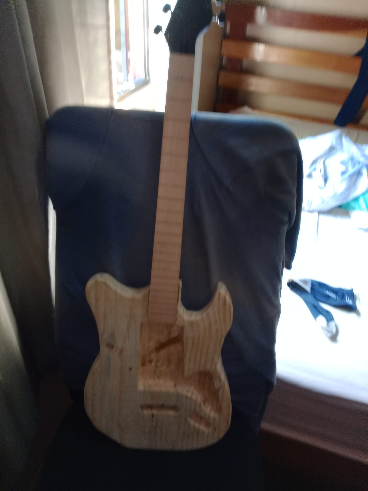
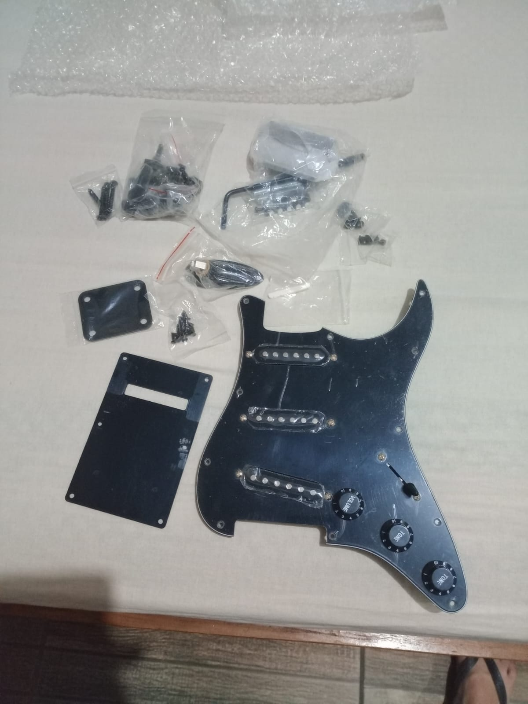
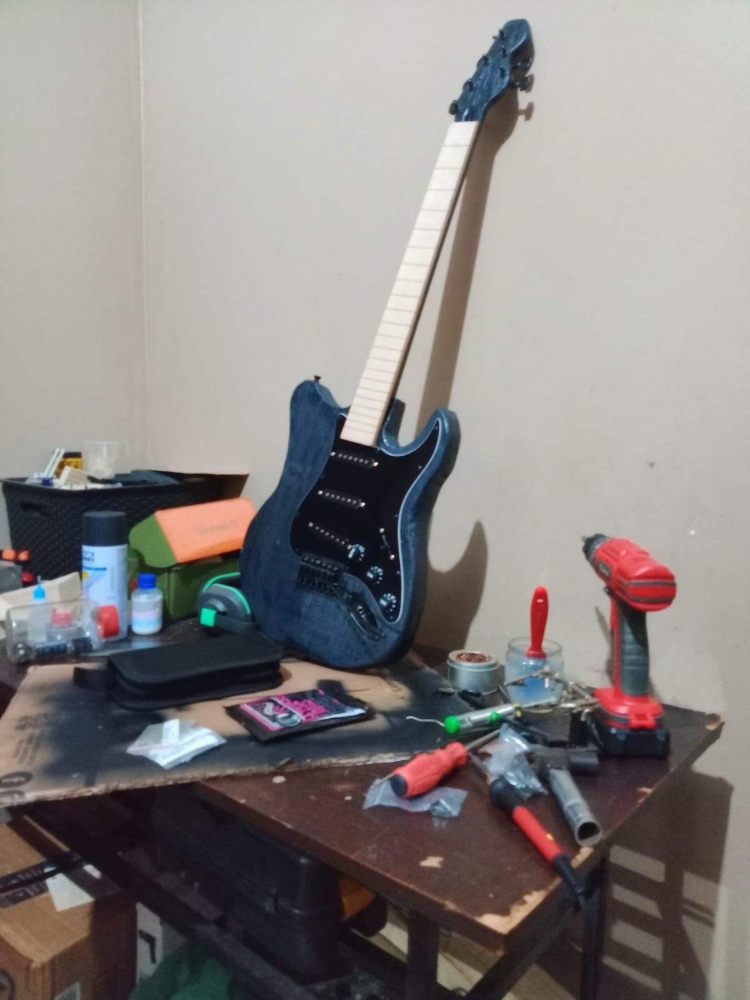

# 🎸 DIY Custom Electric Guitar (First Luthier Project)

## 📌 Overview
This project documents my **very first experience in woodworking and guitar building (lutheria)**. Built entirely from scratch over the course of **one week**, this project was an experimental hands-on learning journey covering body shaping, neck crafting, shielding, and final setup.

---

## 🪵 Materials & Specs
* **Body:** Pinus Wood (hand-shaped and stained black)
* **Neck:** Pinus Wood with Dual-Action Truss Rod
* **Fretboard:** Pre-made Maple Fretboard (Glued to neck)
* **Electronics:** 3x Single-Coil Pickups, 1 Volume, 2 Tone Controls, 5-Way Switch
* **Shielding:** Aluminum Foil Grounding (Cavity & Pickguard)
* **Setup:** Radius 15" Fret Action & Intonation Adjustment

---

## 🛠️ Build Process & Challenges

### 1. Woodworking & Body Shaping
* Hand-cut and carved the guitar body and neck out of solid pinus wood.
* Installed a dual-action truss rod inside the neck before gluing the pre-cut maple fretboard.

| Body Routing & Shaping | Neck & Headstock Fitting |
| :---: | :---: |
|  |  |

### 2. Mistakes & Fixes (Headstock Drilling)
* **Trial & Error:** On my first attempt, the tuner peg hole positions on the headstock were misaligned. 
* **Correction:** I filled the incorrect holes with wood dowels/glue, re-sanded the headstock surface, and re-drilled the correct layout before painting.

| Headstock Drill Fixes | Clamping & Finishing |
| :---: | :---: |
|  |  |

### 3. Assembly & Shielding
* Applied aluminum foil inside the pickup/control cavities to create a noise-reducing Faraday shield.
* Mounted the black Strat-style pickguard kit with all hardware.

| Electronics & Hardware Kit | Assembly Setup |
| :---: | :---: |
|  |  |

---

## 🎵 Sound Test & Final Result
Despite being a prototype built with basic home tools, the guitar is fully functional, holds tuning, and produces a clean single-coil sound.

* **Fret leveling & action height:** Adjusted to match the 15" radius of the fretboard.

---

👨‍💻 **Builder:** [Iago Abreu]  
🚀 *Open-source DIY instrument design & hardware development.*
